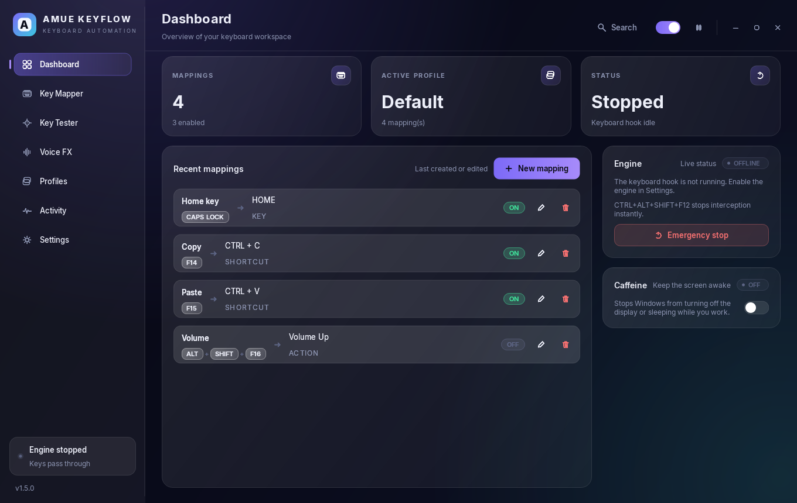
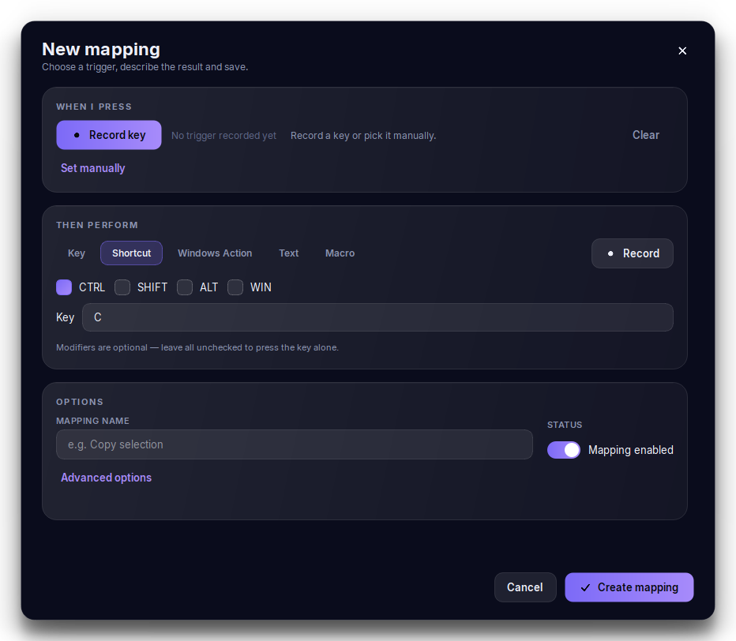
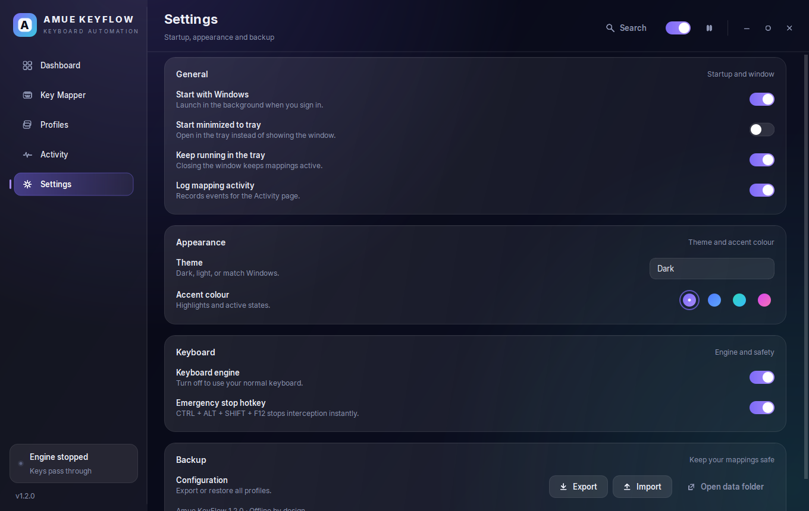
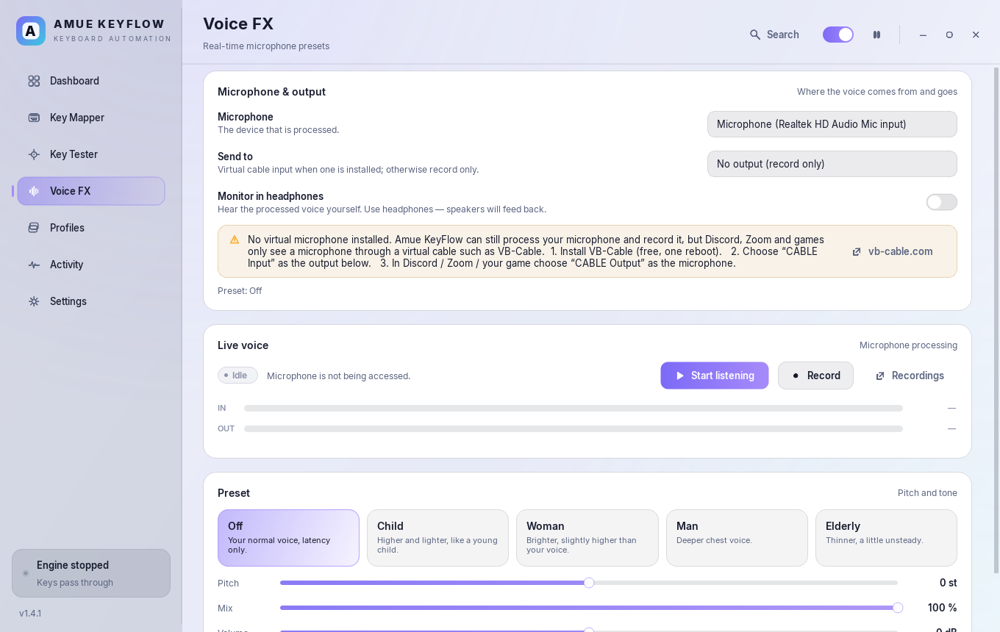
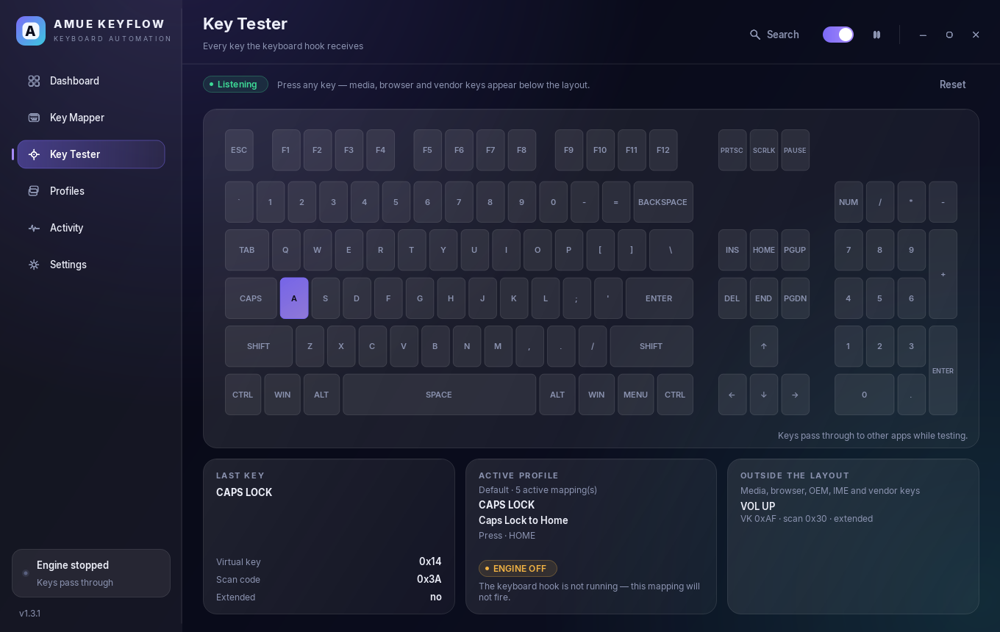

# AMUE KEYFLOW

**Windows keyboard mapper & shortcut automation — a native Python/PySide6 desktop app.**

[**Download the latest installer**](https://github.com/amuejunankar/AmueKeyFlow/releases/latest) ·
[Website](https://amuejunankar.github.io/AmueKeyFlow/) ·
[All releases](https://github.com/amuejunankar/AmueKeyFlow/releases)

Amue KeyFlow intercepts physical keys with a Windows low-level keyboard hook, lets you
build mappings entirely through the GUI, and replays the result with `SendInput`.

There are **no hardcoded mappings**. Every mapping is created, edited, enabled,
disabled and deleted by you. Profiles, activity logging, startup integration and
import/export are all built in.


## Screens









---

## Highlights

- **Mapping editor** — record a physical combination or pick keys manually, then map to a key,
  a shortcut, a Windows action, typed text, or a multi-step macro.
- **Voice FX** — real-time microphone presets (Child, Woman, Man, Elderly) built from pitch
  shift plus formant-ish EQ, with monitoring, a virtual-cable guide and WAV recording.
- **Key Tester** — a live 104-key diagram that lights up every held key with its virtual-key
  and scan code, plus a list of detected media, browser, OEM, IME and vendor keys that are
  outside a standard layout.
- **Real Windows engine** — `WH_KEYBOARD_LL` capture, `SendInput` playback, injected-event
  tagging to prevent recursion, physical-modifier parking so `ALT + SHIFT + B → PAGE UP`
  sends exactly `PAGE UP`, and clean key-state release.
- **Profiles** — independent mapping sets, instant switching, duplicate/export/import,
  and per-app rules that auto-activate a profile when its app comes to the foreground.
- **Per-app overrides** — keep your profile everywhere and give one app a handful of its
  own keys. Inside that app the override wins for the chords it defines; everything else,
  and every other app, behaves normally.
- **Safety first** — emergency disable hotkey (`CTRL + ALT + SHIFT + F12`), pause, full
  engine stop, hook watchdog with automatic recovery, key-state cleanup, and automatic
  database backups.
- **Premium dark glass UI** — custom QSS theme, painted cards, chips, animated switches,
  bundled Inter font, plus a light and system theme with four accent colours.
- **Caffeine** — one switch keeps the display and the computer awake while it is on, so
  long recordings, calls and downloads never get interrupted by the screensaver or sleep.
  It lives on the dashboard and in the tray menu, and the choice survives a restart.
- **System tray** — closing the window keeps the engine running; tray menu exposes
  enable/disable, pause/resume, profile switching, Caffeine, settings and exit.
- **Per-user startup** — `HKCU\…\Run` entry, no administrator rights, no duplicates,
  optional "start minimized to tray".
- **Offline by design** — no telemetry, no network calls, SQLite storage.

---

## Requirements

| | |
|---|---|
| OS | Windows 10 or Windows 11 (64-bit) |
| Runtime for source | Python 3.11+ (developed and built with 3.11.9) |
| Dependencies | `PySide6`, `numpy`, `sounddevice`, `pedalboard` (see `requirements.txt`) |
| Installer build | PyInstaller 6.6+ and Inno Setup 6 |
| End users | nothing — the EXE is self-contained |

---

## Quick start

### From the executable

Run `dist\AmueKeyFlow\AmueKeyFlow.exe` (after building, see below), or build the
installer and run `installer\output\AmueKeyFlow-1.6.0-Setup.exe`.

### From source

```powershell
python -m pip install -r requirements.txt
python main.py
```

The app starts minimized only if you configured it to; otherwise the dashboard opens.
Closing the window keeps it in the tray. Exit from the tray menu.

> The keyboard hook is per-session and does **not** require administrator rights for
> normal desktop applications. Elevated windows are covered in
> [Limitations](#windows-limitations).

---

## Create your first mapping

1. **Key Mapper → Add New Mapping**
2. **When I press** — click **Record key** and press a combination (e.g. `ALT + SHIFT + B`),
   or use the manual modifier checkboxes and searchable key list (letters, digits,
   `F1`–`F24`, navigation, numpad, media and system keys).
3. **Then perform** — choose one of the output types below, or click **Record** in that
   section and press the key or shortcut you want to send (no manual picking needed):
   - **Key** — a single key (`PAGE UP`, `F13`, `MEDIA PLAY/PAUSE`, …)
   - **Shortcut** — optional modifiers + any key (`CTRL + C`, `WIN + D`, `PAGE UP` with no
     modifiers, …); every key is assignable through this tab
   - **Windows Action** — Volume Up/Down, Mute, Play/Pause, Next/Previous track,
     Lock Workstation, Task View, Show Desktop
   - **Text** — literal text typed when the mapping fires (newlines supported)
   - **Macro** — ordered steps: key press, shortcut, type text, wait (ms); add, edit,
     reorder and delete steps
4. **Options** — name, description, trigger behaviour, delay, enabled toggle.
5. **Create mapping.** Conflicts with another mapping using the same input are detected
   and confirmed before saving — nothing is silently overwritten.

### Trigger behaviours

| Behaviour | Semantics |
|---|---|
| On key press | Fires once per physical press; auto-repeat follows the repeat setting |
| On key release | Fires when the trigger key is released (modifiers are still held) |
| While key is held | Fires on press and repeats until released (repeats at the repeat-throttle interval) |
| Toggle (latch) | Press latches the output keys down; press again releases them. Available for **Key** and **Shortcut** outputs |

Modifier-only triggers are not supported: Windows delivers modifiers as state, not as
completable chords. Recording requires at least one non-modifier key.

### Output behaviour details

- Shortcut and key outputs are injected with `SendInput`; media/volume actions use the
  documented media virtual keys and `LockWorkStation()`.
- Before injecting a combination, physically held modifiers are released, the output is
  sent, then the modifiers are re-pressed. This prevents `PAGE UP` from becoming
  `ALT + SHIFT + PAGE UP`, and keeps your keyboard state consistent.
- Text output uses `KEYEVENTF_UNICODE`, so it is independent of the active keyboard layout.
- Macro steps run sequentially on a worker thread; the hook never blocks.

---

## Key Tester



The **Key Tester** page draws a full 104-key diagram and lights up each key while it is
held. One card shows the last key's virtual-key code, scan code and extended flag;
another shows which mapping in the active profile the pressed chord triggers, with its
name, output and trigger mode, so a mapping can be verified without leaving the page.

- The mapping panel resolves chords exactly like the engine (including left/right
  modifier variants) and tells you when the engine is off, paused, disabled or
  emergency-stopped, so an unfired mapping is never mistaken for a broken one.
- Keys are only observed — they still reach the foreground application while you test.
- The tester uses its own non-intercepting hook, so it keeps working when mappings are
  paused, disabled or emergency-stopped.
- Keys that are not on a standard keyboard (media, browser, OEM, IME and vendor keys,
  `F13`–`F24`) are listed under the diagram with their virtual-key and scan codes. The
  name Windows reports is shown when there is one, otherwise the raw codes are.
- It reports what the Windows low-level keyboard hook receives. Keys delivered by a
  vendor driver or a non-keyboard device stack never reach that hook, so no tester built
  on the hook can see them.

---

## Voice FX

Real-time microphone processing on its own page. Five presets — **Off, Child, Woman, Man,
Elderly** — plus a pitch fine-tune (±12 semitones), a dry/wet mix and output volume.
Press **Start listening** and the processed voice goes to the selected output; press
**Record** for a WAV copy of exactly what the effect produces.

**What the presets actually do.** Each one is a pitch shift plus tone shaping (high/low
pass, shelf and presence bands), with compression, light saturation or tremolo for
character. That is how consumer voice changers work, and it is convincing on calls — but
it is **not AI voice conversion**, so it still sounds like a processed version of you
rather than a different speaker. Formant-accurate child/elderly voices would need an ML
model, which this app does not include.

**Other apps (Discord, Zoom, games) need a virtual microphone.** Windows gives applications
the audio of a *device*; a normal program cannot insert itself as one. Install
[VB-Cable](https://vb-audio.com/Cable/) (free, needs a reboot), choose **CABLE Input** as
the output in Amue KeyFlow, then choose **CABLE Output** as the microphone in the other
app. Amue KeyFlow detects the cable, never installs drivers itself (the installer needs
no administrator rights), and works without it: you can still monitor in headphones and
record WAV files.

- **Nothing is captured until you press Start**, and the choice is remembered. Monitoring
  is off by default and warns about feedback when it would play through speakers.
- **Latency** is about 43 ms from the effect window plus the device buffers (≈55 ms
  measured here). The status line shows the live figure.
- **Recording** writes 48 kHz 16-bit mono WAVs to `%APPDATA%\AmueKeyFlow\recordings\`.
  While it runs the page shows a pulsing REC badge with elapsed time, file name and size,
  and the WAV header is updated continuously, so the file is playable before you stop.
- **Levels** are real dBFS (-60…0 dB) with a peak-hold marker and a numeric readout, and
  the fill turns amber above -9 dB and red above -3 dB — a healthy microphone sits in green.
- **Robust device opening** — if a device rejects the first channel layout or never
  delivers a single audio block, the engine retries other layouts and only reports
  "Listening" once real audio is flowing, so a dead stream is never shown as working.
- **Privacy-blocked microphone**, an exclusive-mode device or an unplugged microphone is
  reported in plain language instead of failing silently, and the stream stops cleanly
  when the app exits.

---

## Profiles

- Create, rename, duplicate, delete, activate, export and import profiles.
- Every profile owns its mappings and their enabled state.
- Switching profiles reloads the engine immediately — no restart.
- You cannot delete the active profile or the last remaining profile.
- Import merges profiles by name and skips mappings whose input already exists in that
  profile (or replaces everything if you explicitly choose that and confirm).

### Per-app profile rules

Assign applications to a profile so it activates automatically when one of them comes to
the foreground (for example a *Browsing* profile for `chrome.exe`).

1. **Profiles → app-rules icon** on a profile (the small window button next to the other
   profile actions).
2. The app you were using just before switching to Amue KeyFlow is **preselected** — click
   **Add app**. You can also pick another running app from the list or type an `.exe` name.
3. Repeat for any other apps; remove a rule with its trash button.

Details:

- A rule stores only the executable name (`chrome.exe`); nothing is read from the app.
- One executable belongs to exactly one profile — adding it elsewhere is rejected with the
  owning profile named.
- Apps without a rule leave the current profile alone; Amue KeyFlow never switches back to
  a “default” on its own.
- Switching is skipped while a dialog (editor, recorder, settings) is open, so it can never
  interrupt what you are doing.
- Turn the whole behaviour off with **Auto-switch by app** on the Profiles page.
- Rules are included in profile/all exports and restored on import when the executable is
  not already claimed.

### Per-app overrides

A profile switch gives an app a whole different mapping set. An **app override** is
lighter: it keeps the active profile and layers a few extra mappings on top while one app
is in front.

1. **Key Mapper → scope list** (top left) → **Add app override…**, then pick the app that
   is already running or type its `.exe` name.
2. The page now shows that app's mappings; add them exactly like a profile mapping.
3. Switch back to `Profile · <name>` at any time. Every override is in the same list.

How it behaves:

- Where an override maps a key the profile also maps, the override wins **in that app**
  (for example `CTRL+S → CTRL+SHIFT+S` in Figma only). Keys the override does not mention
  keep working normally.
- Outside the app the override does nothing; the profile always applies.
- Overrides layer on whichever profile is active, so they keep working when an app rule
  switches profiles.
- Duplicate keys inside one override are flagged like profile duplicates; an override
  repeating a profile key is intended and never flagged.
- **Apply this app's mappings** turns the whole override off without deleting it; the
  trash button removes it together with its mappings.
- The live override is shown in the sidebar while it is active.
- Overrides travel with **Export all** (version 2 files) and imports; version 1 files still
  import and simply have none.

---

## Startup and tray

- **Start with Windows** writes `HKCU\Software\Microsoft\Windows\CurrentVersion\Run`
  with `"…\AmueKeyFlow.exe" --autostart`. It is off by default, verified after writing,
  and updated in place instead of creating duplicates.
- **Start minimized to tray** applies to both manual launches and the autostart entry.
- Tray icon colour reflects state: green (active), amber (paused/disabled), red
  (emergency stop), grey (engine stopped). The tooltip shows the current profile.
- Tray menu: Open, Enable mappings, Disable mappings, Pause mappings, Resume mappings,
  Current profile (radio list), Keep screen awake (Caffeine), Settings, Exit.
- Exit stops the hook, releases every injected key, saves state, backs up the database
  and quits.

---

### Caffeine — keep the screen awake

The dashboard has a **Caffeine** card under the engine panel, and the tray menu has the
same **Keep screen awake** entry (a check mark shows the current state). Both drive the
same Windows power request (`SetThreadExecutionState` with `ES_SYSTEM_REQUIRED |
ES_DISPLAY_REQUIRED | ES_CONTINUOUS`), so the display and the system stay awake while it
is on and normal power management returns the moment it is switched off.

- The setting is stored in the database and restored on the next launch.
- Turning it on is verified before the switch and the tray item report ON; a failure is
  shown in plain language instead of leaving a lie in the UI.
- The request is released on exit, so the app can never keep a machine awake after it has
  been closed.
- It is a per-thread Windows request: nothing is installed, no service runs and no
  administrator rights are needed.

## Safety

| Mechanism | Behaviour |
|---|---|
| Emergency disable | `CTRL + ALT + SHIFT + F12` (configurable on/off) immediately stops interception, releases held outputs and restores a normal keyboard. It works even when mappings are disabled or paused. |
| Pause all | Keys pass through untouched, engine stays installed. |
| Restore normal keyboard | Stops the hook entirely. |
| Recursion protection | Every injected event carries `dwExtraInfo = "KFLW"`; the hook ignores them, so output can never re-trigger a mapping. |
| Repeat control | Block (default), allow, or throttle auto-repeat with a minimum interval. |
| Conflict detection | Duplicate inputs are highlighted in the mapper, warned about in the editor and confirmed before saving. |
| Hook watchdog | If the hook thread dies, it is reinstalled automatically (up to three attempts) and the UI is notified. |
| Cleanup | Engine stop, emergency stop and app exit release every simulated key and physical modifier state. |
| Backups | The database is backed up before migrations, before a destructive import, and on exit (last 20 kept). |
| Errors | Rotating log in `%APPDATA%\AmueKeyFlow\logs\keyflow.log`; injection failures surface as activity errors and notifications. |

Windows secure sequences (`Ctrl+Alt+Del`, secure desktop) cannot be intercepted by
user-mode hooks and are never attempted. UAC/elevated windows are discussed under
limitations.

---

## Settings reference (all functional)

The page only shows the options most people change:

**General** — start with Windows, start minimized to tray, keep running in the tray,
log mapping activity. **Caffeine** (keep the screen awake) is on the dashboard and in the
tray menu rather than in Settings.

**Appearance** — dark / light / follow system, accent colour (violet, blue, cyan, magenta),
applied immediately and persisted.

**Keyboard** — keyboard engine on/off, emergency stop hotkey.

**Backup** — export all, import configuration, open the data folder.

Engine tuning (repeat policy, recording timeout, mapping delay, conflict warnings) and
diagnostics (log level, debug mode) keep safe defaults and are intentionally not exposed
in the UI.

---

## Import / export

Exports are versioned JSON:

```json
{
  "app": "Amue KeyFlow",
  "schema": "amue-keyflow-config",
  "version": 1,
  "exported_at": "2026-01-01T12:00:00+00:00",
  "profiles": [
    {
      "name": "Default",
      "description": "",
      "mappings": [
        {
          "name": "Copy",
          "description": "",
          "input": {"mods": ["ctrl"], "key": "b"},
          "output": {"mods": ["ctrl"], "key": "c"},
          "type": "shortcut",
          "trigger": "press",
          "delay": 0,
          "enabled": true
        }
      ]
    }
  ]
}
```

Version 2 files add an optional top-level `app_overrides` list, whose mapping objects are
identical to the ones above:

```json
"app_overrides": [
  {
    "name": "Figma",
    "executable": "figma.exe",
    "enabled": true,
    "mappings": [
      {
        "name": "Save copy",
        "input": {"mods": ["ctrl"], "key": "s"},
        "output": {"mods": ["ctrl", "shift"], "key": "s"},
        "type": "shortcut",
        "trigger": "press",
        "delay": 0,
        "enabled": true
      }
    ]
  }
]
```

Version 1 files still import; they simply contain no overrides.

Validation rejects: non-JSON files, files over 2 MB, unknown schema or newer versions,
unknown keys/types/actions/trigger values, oversized profiles, duplicate profile names,
duplicate inputs inside a profile, duplicate or invalid app overrides, and invalid delays.
Imported data is treated purely as data — nothing is evaluated. Merge is the default; replace requires an additional
confirmation and creates a backup first.

Configuration migration is versioned with `PRAGMA user_version`; newer builds can add
migrations without losing data.

---

## Data locations

| Path | Content |
|---|---|
| `%APPDATA%\AmueKeyFlow\keyflow.db` | SQLite database (profiles, mappings, settings, activity) |
| `%APPDATA%\AmueKeyFlow\backups\` | Automatic database backups |
| `%APPDATA%\AmueKeyFlow\logs\keyflow.log` | Rotating log (5 × 1.5 MB) |
| `%APPDATA%\AmueKeyFlow\exports\` | Default export location |
| `%APPDATA%\AmueKeyFlow\recordings\` | Voice FX WAV recordings |

`AMUE_KEYFLOW_DATA_DIR` overrides the data directory (useful for testing).

---

## Project structure

```
amue-keyflow/
├── main.py                     entry point
├── requirements.txt
├── README.md / LICENSE
├── app/
│   ├── application.py          bootstrap, AppController, import/export commands
│   ├── constants.py            paths, defaults, accents, actions
│   ├── ui/
│   │   ├── main_window.py      frameless shell, native resize, page routing
│   │   ├── sidebar.py topbar.py base_page.py
│   │   ├── dashboard.py key_mapper.py mapping_editor.py
│   │   ├── profiles.py activity.py settings.py voice_fx.py
│   │   ├── theme.py icons.py
│   │   └── components/         cards, chips, buttons, toggle, dialogs, rows, empty state
│   ├── audio/
│   │   ├── presets.py          preset table + pedalboard chain
│   │   ├── processor.py        streaming overlap-add + soft limiter
│   │   ├── voice_engine.py     microphone/output streams, meters, recording
│   │   ├── devices.py          device discovery, host-API ranking, cable check
│   │   └── recorder.py         WAV writer thread
│   ├── engine/
│   │   ├── keyboard_hook.py    WH_KEYBOARD_LL on a message-loop thread
│   │   ├── keyboard_simulator.py SendInput, text, media actions, key parking
│   │   ├── mapping_processor.py pure resolution/suppression/repeat logic
│   │   ├── engine.py           hook + worker + delays + hold/toggle + watchdog
│   │   ├── key_recorder.py     physical chord capture
│   │   ├── conflict_detector.py
│   │   ├── safety_manager.py
│   │   ├── keycodes.py         VK tables, chord parsing/formatting
│   │   └── output_spec.py      output/macro validation + descriptions
│   ├── database/               database.py models.py migrations.py
│   ├── services/               profiles, settings, startup, tray, activity, import/export
│   └── resources/              Inter fonts, generated icon, icon licence
├── tests/                      87 automated tests
├── tools/                      make_icon.py, smoke_ui.py, engine_check.py
├── build/                      PyInstaller spec, version info, build.ps1
└── installer/                  Inno Setup script + instructions
```

---

## Build the executable

```powershell
python -m pip install -r requirements-dev.txt
python tools/make_icon.py
python -m pytest -q
python -m PyInstaller --noconfirm --clean build/amue_keyflow.spec
```

Output: `dist\AmueKeyFlow\AmueKeyFlow.exe` (windowed, custom icon, bundled fonts and
resources, no console window). Or simply:

```powershell
powershell -ExecutionPolicy Bypass -File build\build.ps1
```

### Build the installer

```powershell
& "C:\Program Files (x86)\Inno Setup 6\ISCC.exe" installer\amue_keyflow.iss
```

Result: `installer\output\AmueKeyFlow-1.6.0-Setup.exe` (~46 MB; the audio engine adds
about 12 MB). The script is compatible
with Inno Setup 6.0.5 and newer and was compiled and install-tested here. The installer
offers Start Menu and optional desktop shortcuts, an optional per-user startup entry,
and an option to launch the app after installation. See `installer/README.md`.

The installer always uses the per-user location
`%LOCALAPPDATA%\Programs\Amue KeyFlow` (no administrator rights), so a newer version
replaces the installed one in place. An older copy at `C:\Program Files\Amue KeyFlow`
from an earlier elevated install is removed first, and `%APPDATA%\AmueKeyFlow` — profiles,
mappings, app rules and settings — is never touched by an install or uninstall.

Build outputs are not committed. After the two commands above you have:

```
dist\AmueKeyFlow\AmueKeyFlow.exe                     portable build
installer\output\AmueKeyFlow-1.6.0-Setup.exe        installer
```

---

## Tests and verification status

Automated (`python -m pytest -q`): **87 passed** — mapping resolution/suppression,
repeat policies, release/toggle/hold triggers, specific modifiers, emergency hotkey,
conflict detection, profile lifecycle and persistence, settings persistence, migration
version, import validation (malformed/oversized/duplicate/invalid outputs), export/import
round-trips, activity logging, chord formatting, voice preset parameters and clamping,
virtual-cable detection, streaming processor level/continuity, WAV header patching while
recording, per-app override layering and scoping (an override beats the profile chord in its
app and nowhere else), the version 2 → 3 database migration, override import/export, and the
guarantee that audio devices are never re-enumerated under a live stream (which used to abort
it and silence recordings).

UI smoke test (`python tools/smoke_ui.py`): builds the controller, every page, the editor,
dark/light themes and exports for all screens; rendered screenshots were inspected and
layout/icon defects found there were fixed.

Live engine check (`python tools/engine_check.py`, run on Windows): hook installs and
reports running; `SendInput` key and Unicode-text output arrive in the focused window;
injected events do not re-trigger mappings; emergency stop stops the hook and releases
input.

### Manual acceptance checklist

| # | Test | Status |
|---|---|---|
| 1 | `F14 → CTRL + C` then press F14 | Injection verified; physical F14 press must be checked on your keyboard (F13–F24 may not exist on laptop keyboards) |
| 2 | `F15 → CTRL + V` | Same as above |
| 3 | `ALT + SHIFT + B → PAGE UP`, original suppressed | Resolution/suppression unit-tested; confirm the physical chord on your keyboard |
| 4 | Disable a mapping, original key works | Unit-tested (disabled mappings pass through); toggle in the UI to confirm |
| 5 | Restart the app, mappings remain | Automated persistence tests; reopen the app to confirm |
| 6 | Restart Windows with startup enabled | Registry integration implemented and verified; requires a real logoff/reboot |
| 7 | Close window → tray, mappings still work | Implemented; verify on your desktop session |
| 8 | Switch profiles, only active mappings fire | Profile-scoped mapping tests pass; engine reload is instant |
| 9 | Duplicate inputs show a conflict warning | Detector unit-tested and shown in the mapper/editor; confirm the dialog |
| 10 | Exit restores normal keyboard | Engine stop + key release verified by `engine_check`; confirm after exiting |
| 11 | Multiple modifiers | Unit-tested (CTRL+SHIFT, specific left/right modifiers) |
| 12 | Emergency disable and recovery | Hook stop verified; press `CTRL+ALT+SHIFT+F12` to confirm, then Settings → Resume engine |
| 13 | Voice FX preset audibly changes your voice | Offline path verified: every preset runs the real chain, is level-matched within ~1 dB and the packaged EXE opens the microphone and the effect chain (see `tools/audio_check.py`). Whether Child/Elderly *sound* convincing must be judged by ear |
| 14 | Virtual microphone in Discord/Zoom | Not testable here (no VB-Cable installed). The page detects it, fills in CABLE Input automatically and explains the CABLE Output step |
| 15 | EXE on a clean Windows machine | The PyInstaller bundle and the compiled installer were installed, launched and uninstalled successfully on this machine (Python is bundled, not required). A pristine VM was not available here, so this exact item remains a manual check |

Synthetic input cannot be used to prove physical-trigger behaviour: injected events are
(some of course) tagged and deliberately ignored by the hook — that is the recursion
protection. Physical key tests therefore need a human at the keyboard, as listed above.

---

## Windows limitations

- **Elevated windows** — a non-elevated hook does not see input destined for
  administrator windows (UIPI), and `SendInput` from a medium-integrity process is blocked
  from injecting into elevated processes. Run Amue KeyFlow as administrator if you need
  coverage there; the app reports injection failures instead of failing silently.
- **Secure sequences** — `Ctrl+Alt+Del`, the secure desktop, UAC prompts and some
  anti-cheat/protected applications cannot be intercepted or injected by user-mode
  software. Amue KeyFlow never attempts to bypass Windows security.
- **Keys Windows does not deliver** — some vendor keys, laptop `Fn` combinations and
  media keys handled by firmware never reach the hook. `F13`–`F24` only work if your
  keyboard or OS actually emits them.
- **Games with kernel anti-cheat** may block or flag user-mode hooks. Use a profile with
  mappings disabled (or exit) for those titles.
- **Remote Desktop / virtual machines** forward keys differently; behaviour can vary.
- **Multiple keyboard layouts** — triggers are virtual-key based, so a mapping for a
  letter follows the active layout; text output is layout-independent.
- **Toggle mode** holds the output keys down until pressed again; it is intentionally
  limited to Key/Shortcut outputs.
- **Modifier-only triggers** are not supported (Windows treats them as state).
- **Hardware remapping** (keyboard firmware, KVM, vendor drivers) happens below Windows
  and cannot be seen or changed by this app.

---

## Troubleshooting

| Symptom | Fix |
|---|---|
| Status is "Engine stopped" | Settings → Keyboard engine on, or Settings → Resume engine. Check the log for hook errors. |
| Mapping exists but nothing happens | Confirm the mapping and profile are enabled, mappings are globally enabled and not paused; check Activity for errors. |
| Output blocked in one app | That window is probably elevated; run Amue KeyFlow as administrator. |
| A key no longer works normally | Tray → Disable mappings, or press `CTRL+ALT+SHIFT+F12`; Settings → Restore normal keyboard stops the hook completely. |
| Startup entry missing | Settings → General → Start with Windows; the registry value is `HKCU\…\Run\AmueKeyFlow`. |
| High CPU | The engine is event-driven; idle CPU is near zero. A stuck auto-repeat mapping can be paused via the tray. |

Logs: `%APPDATA%\AmueKeyFlow\logs\keyflow.log`.

---

## License

MIT — see `LICENSE`. Bundled Inter font: SIL Open Font License 1.1
(`app/resources/fonts/OFL.txt`).
